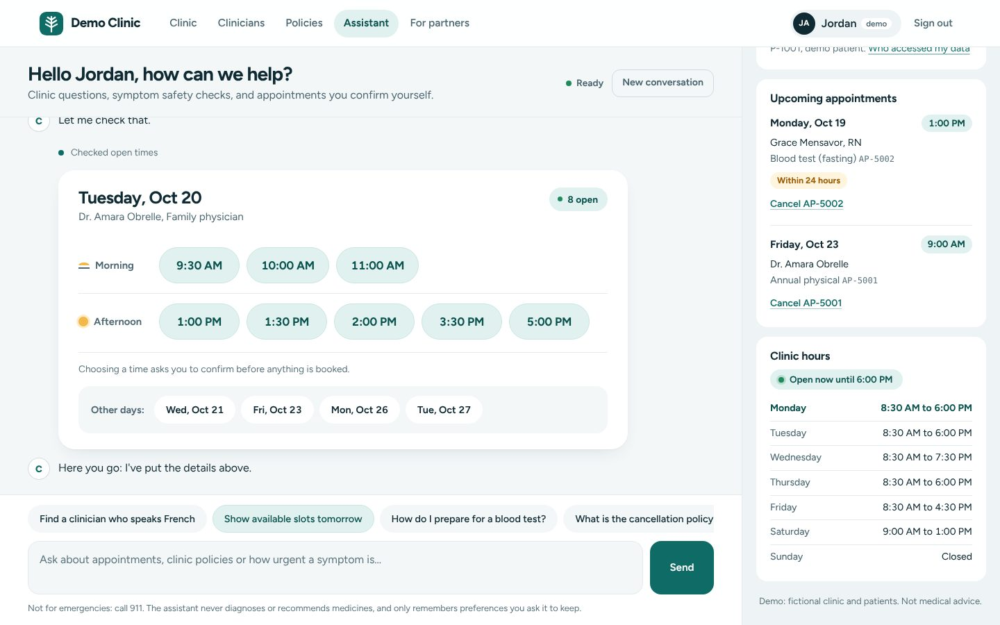
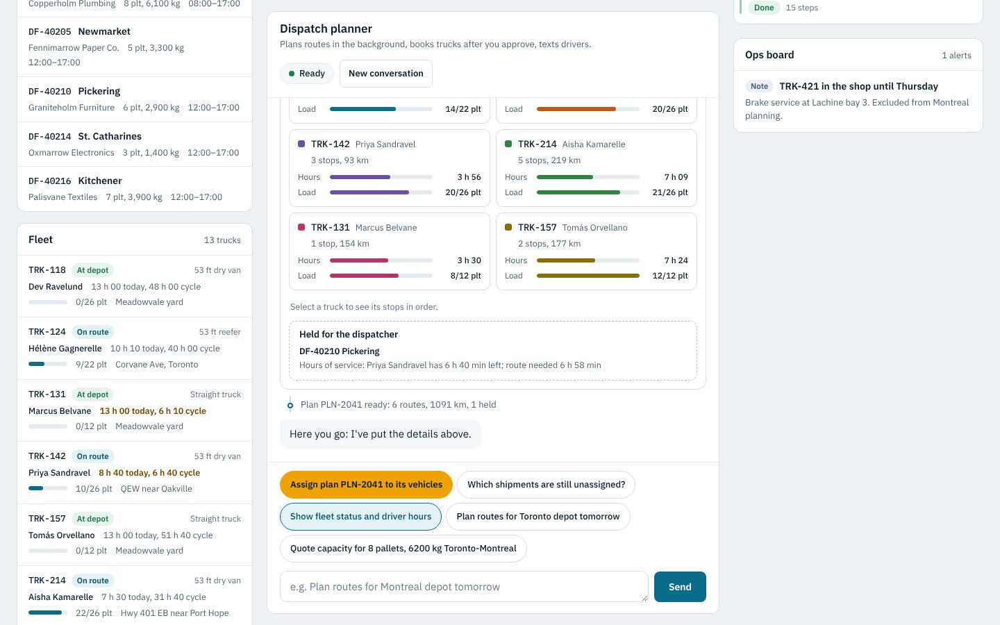

# Amoxi

[](https://github.com/karawash-projects/amoxi/actions/workflows/ci.yml)
[](https://www.npmjs.com/package/amoxi)
[](LICENSE)

**Website and documentation: [karawash-projects.github.io/amoxi](https://karawash-projects.github.io/amoxi/)**

**A full-stack TypeScript framework for Node.js and AI agents.** Compile-time dependency injection modelled on Micronaut, server-rendered JSX pages with islands of interactivity, durable streaming AI agents with generative UI, and the production plumbing a real deployment needs.

- **Compile-time wiring.** `amoxi build` reads your decorators and types with the TypeScript compiler, validates the whole dependency graph, and generates plain wiring code. No reflection at runtime; the framework starts in about 10 ms.
- **Fast pages, little JavaScript.** Pages are JSX rendered on the server straight to HTML strings. Interactive parts are *islands*: small components bundled separately and loaded only where used. The example app's signal-based islands come to about 9 kB of JavaScript (gzipped) in total; React islands are available where you want React libraries.
- **Feels like a single-page app.** Links navigate without full reloads and prefetch on hover; slow sections stream in; responses can be cached with stale-while-revalidate.
- **Ready for AI agents.** Agents run as durable background work that survives restarts, stream token by token, pause for human approval, show your own components (generative UI), remember and search your documents. Their tools' schemas are generated from your TypeScript types. Every page is also readable by AI as markdown or JSON, with `/llms.txt`, and your tools and agents can be offered to other agents over MCP and A2A.
- **Mistakes fail the build.** Missing or ambiguous beans, dependency cycles, bad routes, misnamed islands, server code imported into the browser, and invalid validation rules all stop `amoxi build` with a file and line.

## Get started

```bash
npx create-amoxi-app@latest my-app
cd my-app
npm run dev                             # http://localhost:8080
```

Like `npx create-next-app@latest`. The generator asks for a template (`web`: pages, islands and a JSON API; `agent`: the same plus an AI agent with a streaming chat; `api`: JSON API only; `web` is used with `--yes` or when it isn't run in a terminal), installs dependencies and makes an initial git commit. Options: `--template`, `--no-install`, `--no-git`, `--yes`. Each command is on its own line so the steps work the same in PowerShell, Command Prompt, bash and zsh.

Requires Node.js 22 or newer; works on Windows, macOS and Linux. No environment variables are needed, in development or production. Code generated by `create-amoxi-app` is yours: the starter templates are licensed 0BSD, with no attribution required.

| | Next.js | Amoxi |
|---|---|---|
| Create an app | `npx create-next-app@latest my-app` | `npx create-amoxi-app@latest my-app` |
| Package | `next` | `amoxi` |
| Import | `import ... from 'next'` | `import ... from 'amoxi'` |
| Develop / build / run | `next dev` / `next build` / `next start` | `amoxi dev` / `amoxi build` / `amoxi start` |

To work on Amoxi itself, or try unreleased changes, see [CONTRIBUTING.md](CONTRIBUTING.md).

---

## Contents

1. [How it works](#how-it-works)
2. [Backend: beans, configuration, routes](#backend)
3. [Frontend: pages, islands, navigation, streaming](#frontend)
4. [Data and security: validation, sessions, caching](#data-and-security)
5. [AI agents: tools, durable runs, streaming, approvals, generative UI, memory, RAG, MCP, A2A](#ai-agents)
6. [More: conditions, request scope, AOP, WebSockets, uploads, i18n, OpenAPI, static export](#more-features)
7. [Developing and deploying your app](#developing-and-deploying-your-app)
8. [Configuration reference](#configuration-reference)
9. [Measured performance](#measured-performance)
10. [Comparison with Next.js](#comparison-with-nextjs)
11. [Project layout](#project-layout)
12. [Sector examples](#sector-examples)
13. [Status, versioning and support](#status-versioning-and-support)
14. [Contributing](#contributing) and [License](#license)

---

## How it works

```
            BUILD TIME (amoxi build)                           RUNTIME
┌─────────────────────────────────────────┐        ┌────────────────────────────────┐
│ your .ts/.tsx (decorators are markers)   │        │ AmoxiApplication.run(module)  │
│        │                                 │        │   ApplicationContext:          │
│ TypeScript compiler + type checker       │        │     instances[id] ??=          │
│        │                                 │ emits  │       beans[id].create(r)      │
│ analyzer  → beans, routes, pages,        │ ─────> │   HTTP pipeline: security,     │
│             body schemas, islands        │        │     CSRF, middleware, cache,   │
│ validator → missing/ambiguous/cycles     │        │     validation, compression    │
│ codegen   → wiring + validators + routes │        │   Pages: JSX → HTML strings    │
│ esbuild   → island bundles, CSS (hashed) │        │   Browser: islands + router    │
└─────────────────────────────────────────┘        └────────────────────────────────┘
```

Decorators are no-op functions at runtime: no `reflect-metadata`, no `emitDecoratorMetadata`. Everything they describe is turned into ordinary code in `src/generated/amoxi.generated.ts`, which `tsc` then type-checks a second time.

### Standard decorators

Amoxi works with standard decorators, the TypeScript 5 default, so `experimentalDecorators` is not needed. Standard decorators can't be placed on parameters, so parameters are marked with types of the same name instead; inside the method each one is just its plain type:

| Parameter | Type (standard decorators) | Decorator (`experimentalDecorators`) |
|---|---|---|
| Path segment | `id: PathParam<number>`, `PathParam<string, 'orderId'>` | `@PathParam() id: number` |
| Query string | `page?: QueryParam<number>` | `@QueryParam() page?: number` |
| Header | `requestId: Header<string, 'x-request-id'>` | `@Header('x-request-id') requestId: string` |
| JSON body | `body: Body<NewUser>` | `@Body() body: NewUser` |
| File upload | `form: Multipart` | `@Multipart() form: MultipartForm` |
| Configuration | `port: Value<number, 'server.port', 8080>` | `@Value('${server.port:8080}') port: number` |
| Named bean | `audit: Named<Notifier, 'log'>` | `@Named('log') audit: Notifier` |

New projects use the types. Projects with `experimentalDecorators` can keep the decorators, or use both styles side by side.

---

## Backend

### Beans

```ts
@Singleton()
export class UserService {
  constructor(
    private readonly repository: UserRepository,                 // interface, resolved at build time
    private readonly notifications: NotificationService,
    private readonly maxUsers: Value<number, 'users.max-count', 1000>,
  ) {}
}

@Singleton() @Named('email') export class EmailNotifier implements Notifier { /* ... */ }

@Singleton()
export class NotificationService {
  constructor(
    private readonly notifiers: readonly Notifier[],   // every Notifier
    private readonly audit: Named<Notifier, 'log'>,    // exactly one
  ) {}
}

@Factory()
export class InfrastructureFactory {
  @Bean() clock(): Clock { return new SystemClock(); }  // for classes you can't decorate
}
```

Available: `@Singleton`, `@Prototype`, `@Eager`, `@Primary`, `@Named` (on beans) and `Named<T, 'name'>` (on parameters), `@Factory` + `@Bean`, `Value<T, 'key', default>`, `@PostConstruct`, `@PreDestroy`, optional (`param?: T`) and collection (`T[]`) injection, and injecting `ApplicationContext` itself.

The generated code for a bean is a plain constructor call:

```ts
beans.push({ id: 7, name: "NotificationService", /* ... */
  create: (r: BeanResolver) => new C5([r.get(5), r.get(6)], r.get(6)) });
```

### Routes and middleware

```ts
@Controller('/users')
export class UserController {
  @Get('/:id')
  get(id: PathParam<number>) { ... }            // "abc" → 400, coerced by generated code

  @Get()
  @Cached(30, { staleWhileRevalidate: 60 })
  list(limit?: QueryParam<number>) { ... }

  @Post()
  create(body: Body<NewUser>) { ... }            // validated from the NewUser type
}

@Middleware(0)
export class ServerTimingMiddleware implements HttpMiddleware {
  async handle(ctx: RequestContext, next: () => Promise<unknown>) {
    const start = performance.now();
    const result = await next();
    ctx.res.setHeader('server-timing', `app;dur=${(performance.now() - start).toFixed(2)}`);
    return result;
  }
}
```

Handlers return a value (sent as JSON), a string, `HttpResponse` (`created`, `redirect`, `notFound`, ...), or throw `HttpError`. `RequestContext` gives access to the request id, cookies, session, client IP, protocol, CSP nonce and a `state` object for middleware.

### Build-time errors

```
error AMOXI: src/app.ts:10 - Multiple beans of type 'PaymentGateway' match parameter 'gateway' of 'OrderService':
              StripeGateway, PaypalGateway. Add Named<PaymentGateway, '...'> (or @Named('...')) to the parameter, mark one bean @Primary, or inject 'PaymentGateway[]'
error AMOXI: src/app.ts:13 - Circular dependency: A -> B -> C -> A.
error AMOXI: src/app.ts:21 - Path parameter 'id' in OrderController.get(): route 'GET /orders/:orderId' has no ':id' segment
error AMOXI: src/islands/Leaky.tsx:2 - Browser bundle: Could not resolve "node:fs" (islands run in the browser and may only import browser-safe code)
error AMOXI: src/controller/user-controller.ts:24 - UserController.create() body.email: unknown @format 'mail' (use email, url, uuid, date or date-time)
```

---

## Frontend

Enable JSX in `tsconfig.json`:

```json
"jsx": "react-jsx",
"jsxImportSource": "amoxi"
```

### Pages

```tsx
@Controller()
export class AppPages {
  constructor(private readonly users: UserService) {}

  @Page('/people/:id')
  person(id: PathParam<number>, ctx: RequestContext) {
    const user = this.users.get(id);
    if (!user) return withStatus(404, <NotFound />);
    return (
      <Layout title={user.name}>
        <h1>{user.name}</h1>
        <Island of={DeletePerson} id={user.id} />
      </Layout>
    );
  }

  @ErrorPage(404)
  notFound() { return <Layout title="Page not found">...</Layout>; }
}
```

JSX compiles to escaped string concatenation (about 40 µs for the example's person page). Pages can be async, redirect with `HttpResponse.redirect()`, and work with JavaScript disabled. Global CSS lives in `src/styles/`; reference it with `asset('app.css')` to get the content-hashed URL.

### Islands

Each file in `src/islands/` default-exports one component named after the file. It renders on the server inside the page, then activates in the browser. State uses fine-grained signals that update only the DOM nodes that read them:

```tsx
// src/islands/Counter.tsx
import { navigate, onMount, signal } from 'amoxi';

export default function Counter(props: { start: number }) {
  const [count, setCount] = signal(props.start);
  onMount(() => {
    const id = setInterval(() => setCount((c) => c + 1), 1000);
    return () => clearInterval(id);          // runs when the user navigates away
  });
  return <button onClick={() => navigate('/done')}>Count: {count}</button>;
}
```

Use it with `<Island of={Counter} start={3} load="visible" />` (`load`, `idle` or `visible`). Props are embedded as JSON. Inside islands, `amoxi` resolves to a small browser runtime; importing server-only APIs or Node built-ins fails the build.

### React islands

Any island can be a React component, so React component libraries work (date pickers, charts, UI kits). Name the file `<Name>.react.tsx` and start it with the JSX pragma:

```tsx
// src/islands/AccentPicker.react.tsx
/** @jsxImportSource react */
import { useState } from 'react';
import { HexColorPicker } from 'react-colorful';

export default function AccentPicker(props: { initial: string }) {
  const [color, setColor] = useState(props.initial);
  return <HexColorPicker color={color} onChange={setColor} />;
}
```

```bash
npm install react react-dom
npm install -D @types/react @types/react-dom
```

Use it like any island: `<Island of={AccentPicker} initial="#2F4A66" load="visible" />`. Amoxi renders it on the server with `react-dom/server` and hydrates it in the browser with `hydrateRoot`, so hooks, effects and libraries behave as in any React app, and pages work before JavaScript loads. React (about 60–70 kB gzipped) is bundled into a chunk shared only by React islands, so pages without one never download it; `amoxi build` reports React's cost separately. Mix freely: React islands where you need a library, lightweight signal islands everywhere else.

Good to know:
- Each React island is its own React root, as in Astro: islands don't share React context with each other. Share state through the server, URL or browser storage instead.
- Props are passed as JSON, so they can't be functions, class instances or JSX children.
- Render the same thing on the server and the first time in the browser (read `localStorage`, dates and window size in `useEffect`), or React reports a hydration mismatch, as it would in Next.js.
- The build stops with a clear message if the pragma is missing or React isn't installed.

### Client-side navigation

Every page loads a 0.6 kB entry plus a 3.2 kB shared runtime (gzipped), which turns same-origin link clicks into in-place page swaps:

- prefetch on hover, focus or touch; `data-prefetch="visible"` prefetches when a link scrolls into view
- back/forward with scroll restoration, view transitions where supported, focus moved to `<main>` and the new title announced to screen readers
- islands on the old page are cleaned up; islands on the new page activate
- opt out per link with `data-reload`, `target`, `download` or `rel="external"`; errors fall back to a normal page load

Call `navigate(url)` from islands after a change (it skips the prefetch cache so data is fresh).

### Streaming

```tsx
<Await promise={this.loadStats()} fallback={<p>Loading…</p>}>
  {(stats) => <StatsTable stats={stats} />}
</Await>
```

The page is sent immediately with the fallback; the section streams in when the promise settles (timeouts and errors render a fallback message and are logged). Islands inside streamed sections activate when they arrive.

---

## Data and security

### Request validation from your types

```ts
export interface NewUser {
  /**
   * @minLength 1
   * @maxLength 80
   * @pattern \S
   * @patternMessage must not be blank
   */
  readonly name: string;
  /** @format email */
  readonly email: string;
  readonly role?: 'admin' | 'member';
  readonly tags?: string[];
}
```

`body: Body<NewUser>` (or `@Body() body: NewUser`) gets a validator generated at build time: types, required/optional fields, literal unions, arrays, nested objects, nullable values and records, plus `@minLength`, `@maxLength`, `@pattern`, `@format` (email, url, uuid, date, date-time), `@minimum`, `@maximum`, `@integer`, `@minItems` and `@maxItems`. Failures return 400 with every problem:

```json
{ "error": "Invalid request body",
  "details": [{ "path": "name", "message": "must not be blank" }, { "path": "email", "message": "must be a valid email" }] }
```

The controller receives a sanitized copy containing only declared properties, so extra fields such as `id` or `isAdmin` can't be smuggled in.

### Cookies and sessions

```ts
ctx.cookies.set('theme', 'dark', { maxAge: 3600 });   // HttpOnly, SameSite=Lax, Secure over HTTPS by default
ctx.session.set('recent', [1, 2, 3]);                 // encrypted with AES-256-GCM in a cookie
ctx.session.regenerate();                             // on sign-in: same data, new session id
ctx.session.destroy();                                // logout
```

Sessions need no configuration. Like Next.js does for its Server Actions key, `amoxi build` generates an encryption key and embeds it in the server build (never in browser code), so sessions survive restarts and work across every worker and instance running that build. The key is created once per checkout in `.amoxi/session.key` (git-ignored), so rebuilding on your machine keeps you logged in, but a fresh checkout (a CI job, a Docker build) gets a new key, which logs users out on deploy. To keep users logged in across deploys, optionally set `AMOXI_SESSION_SECRET` (32+ random characters, the same everywhere). Sessions are limited to about 4 KB, the browser's cookie limit.

**Making sign-out final.** Cookie sessions are stateless: `destroy()` removes the cookie from the browser, but a copy taken earlier (for example from a shared computer or by malware) keeps working until it expires (`amoxi.session.max-age`, 7 days by default). For apps where that matters, such as banking or health data, keep the ids of signed-in sessions on the server and check them in a middleware. The banking and clinic examples do exactly this:

```ts
// sign-in:  ctx.session.regenerate(); ctx.session.set('userId', id); activeSessions.add(ctx.session.id);
// sign-out: activeSessions.remove(ctx.session.id); ctx.session.destroy();
// middleware, before anything reads the session:
if (ctx.session.get('userId') !== undefined && !activeSessions.has(ctx.session.id)) ctx.session.destroy();
```

With several servers, store the ids where all of them can see them (a database table or Redis, with an expiry). Also consider a shorter `amoxi.session.max-age`.

### Built-in protection

| Protection | Default |
|---|---|
| Content-Security-Policy with a per-request nonce on the inline scripts you write in JSX and the framework's own (re-nonced on cached pages). HTML inserted with `raw()` never gets a nonce, so injected scripts can't run | on |
| Absolute links in llms.txt and the markdown/JSON page views use `app.url`, or a validated `Host` header; cached views are kept per host, so a forged `Host` can't poison them | on |
| `X-Content-Type-Options`, `X-Frame-Options: DENY`, `Referrer-Policy`, `Cross-Origin-Opener-Policy`, `Permissions-Policy` | on |
| HSTS over HTTPS (direct TLS or `X-Forwarded-Proto` with `server.trust-proxy`) | on in production |
| CSRF: cookie-bearing POST/PUT/PATCH/DELETE must be same-origin (Sec-Fetch-Site, Origin or Referer) | on |
| CORS for listed origins only | off |
| Body size limit (413), JSON-only bodies (415), request/header/keep-alive timeouts; a request answered with an error before its body was read closes the connection | on |
| Malformed input (bad `%`-encoding, broken multipart, WebSocket handshakes) is answered with 400, never a crash; a failed upload write answers 500 | on |
| Static files: no path traversal (`..`, `\`, drive letters, encoded separators), no dotfiles | on |
| Errors: no stack traces or messages in production responses; request id for support | on |

### Caching (like Next.js ISR)

`@Cached(ttl, { staleWhileRevalidate })` on GET routes and pages keeps responses in memory, serves stale copies while re-rendering in the background, and sets `Cache-Control: s-maxage` for CDNs. Call `revalidatePath('/users')` after writes. Only cache content that is identical for every visitor: a cached page that reads the visitor's cookies or session, or a response that sets a cookie, is never stored and is sent with `Cache-Control: private, no-store`, so a CDN can't hand one visitor's page or session to another. The background refresh finishes inside the request that triggered it, so its request-scoped beans (a database transaction, say) stay open until it is done.

---

## AI agents

`amoxi/ai` adds AI agents that run as durable background work, stream their progress token by token, show generative UI, remember, search your documents, and serve other AI agents over MCP and A2A. Like the rest of Amoxi, the wiring is generated at build time: tool schemas and argument validators come from your TypeScript types, not from a schema library.

It works with no API key: without one, a built-in offline model picks tools by keyword and fills in their arguments from the request, so the app, its demo and its tests run anywhere. Add a key to `.env` to use a real model:

```bash
ANTHROPIC_API_KEY=...        # Claude (default model: claude-sonnet-5-5)
# or
OPENAI_API_KEY=...           # OpenAI (default model: gpt-6-luna)
OPENAI_BASE_URL=http://localhost:11434/v1   # optional: any OpenAI-compatible server (Azure OpenAI, Ollama, vLLM, Groq, Mistral)
```

### Agents and tools

```tsx
import { Singleton } from 'amoxi';
import { Agent, Tool, type AgentRunContext, type ToolContext } from 'amoxi/ai';

@Singleton()
export class AccountTools {
  constructor(private readonly ledger: Ledger) {}

  /** The signed-in customer's accounts and balances. */
  @Tool({ readOnly: true })
  listAccounts(_input: {}, ctx: ToolContext): Account[] {
    return this.ledger.accountsOf(String(ctx.principal));
  }

  @Tool({ description: 'Move money between the customer\'s own accounts', approval: true, idempotent: true })
  transfer(input: {
    /** Account to debit, e.g. CHQ-1001 */
    fromAccountId: string;
    toAccountId: string;
    /** @integer @minimum 1 @maximum 1000000 */
    amountCents: number;
  }, ctx: ToolContext): Promise<Receipt> {
    // idempotent + ctx.step: if the server restarts mid-call, the call runs again on resume,
    // and the completed step returns its recorded result instead of posting twice.
    return ctx.step('post', () => this.ledger.transfer(String(ctx.principal), input));
  }
}

/** Answers questions about accounts and moves money between them. */
@Agent({ tools: [AccountTools], ui: ['BalanceChart'], memory: true, examples: ['What did I spend on groceries?'] })
export class BankingAssistant {
  instructions(ctx: AgentRunContext): string {
    return `You are Demo Bank's assistant. Today is ${ctx.now.toDateString()}.`;
  }
  /** Runs happen in the background, so capture who is asking while the request is here. */
  principal(req: RequestContext) {
    return req.session.get<string>('customerId');
  }
  owner(req: RequestContext) {
    return req.session.get<string>('customerId'); // conversations belong to the customer
  }
}
```

- `@Tool` works on any singleton bean. The method's input type becomes the JSON Schema the model sees, including JSDoc descriptions and validation tags; the model's arguments are validated against it before your code runs, and errors go back to the model so it can correct itself. The return type becomes the MCP output schema.
- `@Agent` makes a singleton with `instructions()` (required) and optional hooks: `principal(req)`, `owner(req)`, `beforeToolCall({ tool, input, ctx })` (a guardrail: return a string to refuse) and `onRunFinished(run)` (audit, notifications).
- `@Tool` options: `description`, `name`, `approval`, `readOnly` (no side effects), `idempotent` (safe to re-run, see below), `expose` (offer over MCP).
- **Errors:** throw `ToolError` (from `amoxi/ai`) for a message meant for the model and the person, such as `throw new ToolError('Only 2 left in size M')`; the model can then explain or try something else. In production, any other error (a database error, a bug) reaches them only as "internal error" with a reference id, and the details are logged under that id. `HttpError` messages are shown too.
- `@Agent` options: `tools` (classes), `ui` (generative islands, or `true` for all), `knowledge` (knowledge bases to search), `memory` (`true` or `{ recall, remember }`), `examples`, `maxTurns`, `model`, `name` and `description` (defaults: the class name in kebab-case, the class JSDoc).
- Mistakes fail `amoxi build`: duplicate tool names, a tool class that isn't a bean, an unknown UI component, a missing description or `instructions()`, a non-object tool input.

### Long-running runs, streaming and approvals

A message starts a **run**, which executes in a background worker, not in the HTTP request, so it can take minutes. Every model turn and tool result is checkpointed: if the server stops or crashes mid-run, the run resumes on the next start (or on another worker) from its last step. A tool call that was interrupted part-way is never repeated blindly: by default the model is told the action may or may not have completed. Mark a tool `@Tool({ idempotent: true })` when it is safe to run again, typically because its side effects are wrapped in `ctx.step('key', fn)`: on resume it runs again, and each completed step returns its recorded result instead of running a second time. For a system of your own that takes an idempotency key, use `ctx.callId`: it is the same when an interrupted call runs again, and different for every new call, so asking twice for the same transfer in one conversation really makes two.

| Endpoint | |
|---|---|
| `POST /agents/:agent/runs` `{ input, threadId? }` | Starts a run: `202` with the run, or a live event stream with `Accept: text/event-stream` |
| `GET /agents/:agent/runs/:id` | Status, output, usage and pending approvals |
| `GET /agents/:agent/runs/:id/events` | Server-Sent Events; reconnects resume after `Last-Event-ID` |
| `POST /agents/:agent/runs/:id/approvals/:callId` `{ approved, note? }` | Approves or declines an action |
| `POST /agents/:agent/runs/:id/cancel` | Cancels, also mid-tool (tools receive an `AbortSignal`) |
| `GET /agents/:agent/threads`, `/threads/:id` | The caller's conversations, as chat items |

Events: `message.delta` (tokens), `message.completed`, `tool.started`, `tool.completed`, `ui`, `approval.required`, `progress`, `run.status`, `run.completed`, `run.failed`. Tools with `approval: true` pause the run (`awaiting_approval`) until a person decides; nothing runs before that.

Conversations belong to an owner: an anonymous id in the encrypted session cookie by default, or what `owner(req)` returns (stored as `userOwner(id)`, so your code can list a user's conversations with `platform.threads(userOwner(id), agent)`). Other owners get 404. Runs started over MCP or A2A have the principal `{ channel: 'mcp' }` or `{ channel: 'a2a' }`, so tools and guardrails can tell them apart. Your middleware runs first, so authentication middleware protects the agent endpoints too.

Streaming isn't only for agents: any route can return `eventStream(async function* (signal) { yield { event, data } })` for Server-Sent Events with heartbeats and disconnect handling.

### Chat islands and generative UI

```tsx
// src/islands/BalanceChart.tsx
/** @generative Shows account balances over time as a bar chart */
export default function BalanceChart(props: { title: string; points: Array<{ month: string; cents: number }> }) { ... }
```

An island marked `@generative` can be shown by agents: the model gets a `show_balance_chart` tool whose schema is the props type, tools can show it directly with `ctx.ui('BalanceChart', props)`, and the props are validated against the type either way. In the browser, `agentChat()` gives an island the conversation as signals, and `mountComponent()` renders generative components on demand:

```tsx
import { agentChat, For, mountComponent } from 'amoxi';

export default function Assistant(props: { initial: ChatItem[] }) {
  const chat = agentChat('banking-assistant', { initial: props.initial });
  return (
    <section>
      <For each={chat.items} key={(i) => i.id}>
        {(item) =>
          item.kind === 'ui' ? <div ref={(el) => mountComponent(el, item.component, item.props)} />
          : item.kind === 'approval' ? <Approval item={item} onDecide={(yes) => chat.decide(item.callId, yes)} />
          : <p class={item.kind}>{'text' in item ? item.text : item.kind}</p>}
      </For>
      <form onSubmit={(e) => { e.preventDefault(); void chat.send(input.value); }}>...</form>
    </section>
  );
}
```

`For` keeps each message's DOM while new tokens stream in, so components the agent showed keep their state. To restore a conversation after a reload, fetch `GET /agents/<name>/threads/<id>` and pass its `items` as `initial` and its `activeRun` as `resume`: a run still working keeps streaming, and an approval it waits for is shown again and can be answered. (`toChatItems()` from `amoxi/ai` does the same conversion on the server.)

### Memory and knowledge (RAG)

- `memory: true` recalls the most relevant memories of the person into each run's instructions and gives the model a `remember` tool. Memory is per person (the principal, else the owner) and shared by the app's agents. Inject `MemoryService` to read or seed it.
- `knowledge: ['policies']` gives the agent a `search_knowledge` tool. Inject `KnowledgeBases` to add documents: `knowledge.get('policies').ingest([{ id, title, url, text }])` chunks, embeds and indexes them; re-ingesting a document replaces it.
- Embeddings use an offline hashing embedder by default, or any OpenAI-compatible embeddings API when `OPENAI_API_KEY` (or `ai.embeddings.*`) is set.

### Storage: local by default, PostgreSQL for scale

Runs, conversations and vectors are stored in `data/ai/` (files; nothing to install). For several servers, or production at scale, use PostgreSQL with pgvector: `npm install pg`, then

```json
{ "ai": { "store": { "type": "postgres" } } }
```

with `DATABASE_URL` set. Tables are created on first use. PostgreSQL also turns runs into a shared queue: any number of servers claim runs with `FOR UPDATE SKIP LOCKED`, and instances started with `ai.runs.worker=false` only serve HTTP while others execute runs. To use something else, implement `RunStore`, `ConversationStore`, `VectorStore`, `Embedder` or `ChatModel` in a bean: your implementation replaces the built-in one everywhere.

### Pages for AI agents

Every page is also available to AI agents, with no code:

- `/about.md` (or `Accept: text/markdown`): the page's main content as clean markdown.
- `Accept: application/json`: title, headings, content, links, forms and the page's own data; attach data with `return withData(<Page />, { plans })`.
- `/llms.txt`: an index of the site's pages, APIs and agents ([llmstxt.org](https://llmstxt.org)). HTML pages link to their markdown version.
- `amoxi export` writes the `.md` copies and `llms.txt` too.

Access rules apply to every view automatically: for `/account.md` and `/account/index.md`, middleware and handlers see `ctx.path === '/account'`, and `ctx.representation` tells you whether HTML, markdown or JSON was asked for. Set `app.url` (for example `https://www.example.com`) so absolute links don't depend on the request's `Host` header.

### MCP and A2A: your agents for other agents

```json
{ "ai": { "mcp": { "enabled": true, "token": "a-long-random-secret" }, "a2a": { "enabled": true, "token": "another-long-secret" } } }
```

- **MCP** (`POST /mcp`, Streamable HTTP; protocol 2026-07-28 and the widely used 2025-11-25): Claude, ChatGPT, Cursor and other MCP clients can call your tools (`@Tool({ expose: false })` hides one; tools that need approval are never offered), ask your agents (an `ask_<agent>` tool each), and read your pages as markdown resources.
- **A2A** (`/.well-known/agent-card.json` and `POST /a2a`; versions 1.0 and 0.3): other agents send tasks to yours. Runs map to tasks, threads to contexts, approvals to `input-required`.
- Both are off by default. With a token, callers must send `Authorization: Bearer <token>`; you can also protect them with middleware.
- **Telling callers apart.** Give each caller its own token: `ai.mcp.callers.<name>` and `ai.a2a.callers.<name>` (for example `AI_A2A_CALLERS_PARTNERA=...`). A caller that sends its token owns its conversations as `a2a:<name>` (or `mcp:<name>`): it can list and continue only its own tasks, and facts an agent remembers stay with it. Callers that can't be told apart (one shared `token`, or none) get an owner per conversation instead, so they can't see each other's tasks either; the task and context ids they were given are what let them come back.
- **Approvals over MCP:** an MCP client can't approve on a person's behalf, so when an `ask_<agent>` run wants an action that needs approval, the action is declined, the agent is told why, and it finishes its answer (for example, by telling the user to do it in the app). If your app maps MCP callers to signed-in people, set `ai.mcp.approvals=wait` and the run pauses until that person approves it in the app.
- **Approvals over A2A** work the same way by default (`ai.a2a.approvals=decline`). `wait` pauses for a person in the app; `caller` lets the calling agent approve by replying "approve", so use it only for partners you trust to act for the person.

---

## More features

### Conditional beans: `@Requires`

```ts
@Singleton()
@Requires({ property: 'notifications.slack.webhook' })        // only when configured
export class SlackNotifier implements Notifier { ... }

@Singleton() @Requires({ property: 'mail.provider', value: 'ses' }) export class SesMailer implements Mailer { ... }
@Singleton() @Requires({ property: 'mail.provider', value: 'smtp' }) export class SmtpMailer implements Mailer { ... }
@Singleton() export class LogMailer implements Mailer { ... }  // unconditional: the default
```

Options: `property` (set and not `false`/empty, or equal to `value`), `missing`, `profile` and `notProfile`. Conditions are compiled to plain predicates and evaluated once at startup. An injection point may have several conditional candidates plus one unconditional default; startup fails with a clear message if a configuration enables two of them or leaves a required dependency with none. `T[]` injection receives only enabled beans, and disabled controllers contribute no routes.

### Request-scoped beans and `Provider<T>`

```ts
@RequestScope()
export class RequestTimings {
  constructor(private readonly request: RequestContext) {}   // the current request
}

@Singleton()
export class TimingInterceptor {
  constructor(private readonly timings: Provider<RequestTimings>) {}   // resolved per call
}
```

One instance per HTTP request (carried through `await`s by `AsyncLocalStorage`), with `@PreDestroy` when the request ends. A singleton that injects a request-scoped bean directly is a build error, because it would keep the first request's instance; inject `Provider<T>` and call `get()` (or `getIfAvailable()`, which returns `undefined` outside a request). `Provider<T>` also breaks dependency cycles, since it creates no construction-time edge.

### AOP interceptors: `@Intercept`

```ts
@Singleton()
@Intercept(TimingInterceptor)        // every public method of the class; or put it on single methods
export class UserService { ... }

@Singleton()
export class TimingInterceptor implements MethodInterceptor {
  intercept(invocation: Invocation) {
    const start = performance.now();
    try { return invocation.proceed(); }
    finally { console.log(invocation.bean, invocation.method, performance.now() - start); }
  }
}
```

Interceptors are ordinary beans with their own dependencies. The wrapping is generated at build time (no proxies or reflection); interceptors run in the order listed and may change `invocation.args` before calling `proceed()`. The example uses this to put each `UserService` method's duration into the `Server-Timing` header.

### WebSockets

```ts
@WebSocketEndpoint('/ws/activity')            // path parameters work: '/ws/rooms/:room'
export class ActivitySocket {
  onOpen(socket: WebSocketConnection) { socket.send({ hello: socket.params }); }
  onMessage(socket: WebSocketConnection, data: string | Buffer) { ... }
  onClose(socket: WebSocketConnection, code: number, reason: string) { ... }
}
```

A dependency-free RFC 6455 implementation: masking, fragmentation, ping/pong heartbeats (dead connections are dropped), UTF-8 validation, and limits on message size and on the number of frames a message is split into. A client that stops reading what it is sent stops being read from, and is dropped if its queue keeps growing (`server.websocket.max-buffered-size`); `socket.bufferedAmount` shows how much is waiting. Messages wait until `onOpen` has finished, including any sent together with the upgrade request. `socket.close(code, reason)` accepts the codes RFC 6455 allows (1000-1003, 1007-1014, 3000-4999) and cuts the reason to the 123 bytes a close frame holds; a client's reserved close code is answered with a protocol error. Cross-site connections are refused unless their origin is in `server.cors.origins`. `socket.session` and `socket.cookies` expose the user's session (read-only). Connections close with code 1001 on graceful shutdown. Broadcasts reach clients of the same process only; use a shared channel such as Redis pub/sub across workers.

### File uploads

```ts
@Post('/users/:id/avatar')
async upload(id: PathParam<number>, form: Multipart) {
  const file = form.file('avatar');          // { filename, contentType, size, path, read(), moveTo() }
  await file?.moveTo(`data/avatars/${id}.png`);
}
```

The parser streams file parts straight to temporary files and enforces limits while reading (`server.upload.max-file-size`, `max-files`, `max-fields`, `max-field-size`), so oversized uploads are rejected without being buffered. File names are reduced to a safe base name; temporary files are deleted after the response unless moved. Content types come from the client, so check the bytes when it matters (the example's `AvatarStore` does). `HttpResponse.file(path, { contentType })` streams files back.

### Internationalisation

```json
// src/i18n/en.json (fr.json, de.json, ...)
{ "people": { "title": "People", "count": "{count, plural, =0 {No people} one {# person} other {# people}}" } }
```

```tsx
<h1>{ctx.t('people.title')}</h1>
<p>{ctx.t('people.count', { count: users.length })}</p>
<html lang={ctx.locale}>
```

The locale comes from `?lang=` (remembered in a `amoxi_locale` cookie), then the cookie, then `Accept-Language`, then the default (`en` if present). Missing translations fall back to the default locale. At build time, `ctx.t('literal')` keys that don't exist fail the build, and locales with missing keys or mismatched placeholders produce warnings. Islands receive translated strings as props.

### OpenAPI

`amoxi build` generates an OpenAPI 3.1 document from your routes: path, query and header parameters with their types, request bodies from the same TypeScript types used for validation (including `@format`, `@minLength`...), response types (with `Promise` and `HttpResponse` unwrapped), and summaries from JSDoc comments. It is served at `/amoxi/openapi.json` outside production (`amoxi.openapi.enabled`), and `amoxi build --openapi openapi.json` writes it to a file for client generators or API gateways.

### Static export

```bash
npm run build
npx amoxi export            # writes out/
```

Renders every reachable page to plain HTML: pages without parameters, plus every page their links lead to (for example `/people/1`). Streamed `<Await>` sections are inlined, redirects become forwarding pages, `@ErrorPage(404)` becomes `404.html`, and `public/` (including island bundles) is copied. Islands and client-side navigation keep working on any static host. Use `--routes /a,/b` for pages nothing links to.

A static host only serves files and runs no code, so, as with every framework's static export (Next.js's `output: 'export'` included), the exported site has no API routes, uploads, WebSockets, sessions or cookies, and each page is a snapshot taken at export time. `amoxi export` tells you exactly what that means for your app:

```
warning These pages behave differently as static files:
    /people, /people/1, /people/2: read the session; the static copy shows what a first-time visitor sees
    /people, /people/1, /people/2: read query parameters (?...); static hosts ignore them, so these pages always render as if none were given
warning Not included, because they need a running server (true of every static export):
    API routes: GET /users, POST /users, ..., POST /users/:id/avatar (upload)
    WebSockets: /ws/activity
```

Add `--strict` to fail instead (removing the output), the way Next.js refuses to export pages that read cookies. Need both? Export the pages and run the Amoxi app separately as the API (allowing the site's origin in `server.cors.origins`).

**Hosting under a sub-path** (like Next.js `basePath`), for example GitHub Pages at `https://<owner>.github.io/<repository>/`:

```bash
npx amoxi export --base-path /my-repository
```

Links, images, stylesheets (including their `url(...)` references), forms and island bundles in the exported files get the prefix, and `navigate('/x')` in islands follows it. When an island builds a URL itself, wrap it in `withBasePath('/images/a.png')` from `amoxi`; it returns the path unchanged when there is no base path. The [showcase site](website/) is exported this way by [.github/workflows/pages.yml](.github/workflows/pages.yml).

---

## Developing and deploying your app

Amoxi is a framework: you install it into your own project (created with `create-amoxi-app`) and deploy that project wherever you run Node.js apps. Nothing needs to be configured; everything below is optional tuning.

### Develop: `amoxi dev`

Watches `src/`, `public/`, `application*.json` and `.env` files. On save it re-analyses incrementally (reusing the previous TypeScript program), transpiles with esbuild, restarts the app and refreshes open browser tabs in place, keeping scroll position. Build errors appear as an overlay in the browser and in the terminal; type errors are reported in the background without blocking.

### Build and run

```bash
npm run build      # amoxi build (wiring, validators, browser bundles, precompressed assets), then tsc
npm start          # amoxi start: production mode, one worker per CPU
```

`npx amoxi --help` lists every command and option, and `npx amoxi --version` (or `-v`) prints the version. Unknown options and invalid values are reported as errors rather than ignored.

**Busy ports:** before listening, Amoxi checks whether another program already uses the port. In development (`amoxi dev`) it moves to the next free port and says so, like Next.js; in production it stops with a clear message instead, because a load balancer expects the configured port (`server.port-fallback` overrides either way). Note that this detects programs *listening* on the port; a program that only *sends* requests to it (such as an extension polling `localhost:8080`) can't be detected, and shows up as 404s in your log. Change the port with `SERVER_PORT` if that's noisy.

`amoxi start` sets `NODE_ENV=production` (JSON logs, HSTS, secure cookies, error details hidden), always replaces a worker that crashes (after more than 10 crashes a minute it logs a warning and slows the restarts down, up to 30 s, so a crash loop is visible but the service stays up; if workers fail while *starting*, for example because of bad configuration, it stops with an error instead) and drains everything on SIGINT/SIGTERM. Apps created with `create-amoxi-app` include a `Dockerfile` (multi-stage, runs as a non-root user, health check), so `docker build -t my-app .` then `docker run -p 8080:8080 my-app` works without extra setup.

Build in CI rather than on the server (`npm ci`, `npm run build`, `npm test`), and don't commit `dist/`, `public/_amoxi/` or `src/generated/` (the starter's `.gitignore` already excludes them).

### Hosting checklist

- **Reverse proxy or load balancer** in front for TLS and HTTP/2, as with any Node.js server. Set `server.trust-proxy=true` only when a proxy you control sets `X-Forwarded-For` and `X-Forwarded-Proto`; otherwise clients could fake their IP address and protocol. Amoxi takes the address your proxy appended (the last entry), never the first, which the client controls. With several proxies in a row (a CDN, then a load balancer), set their number, for example `server.trust-proxy=2`.
- **Health checks:** liveness `GET /amoxi/health/live`; readiness `GET /amoxi/health/ready`, which returns 503 while starting or draining so load balancers stop sending traffic before shutdown.
- **Graceful shutdown:** on SIGTERM, readiness turns 503, in-flight requests finish (up to `server.shutdown-timeout`, default 10 s), then `@PreDestroy` hooks run. On Kubernetes, set `terminationGracePeriodSeconds` above that timeout and consider `server.shutdown-delay=5000` so the load balancer notices before connections close.
- **Logs:** one JSON object per line, each request with `requestId`, `status` and `durationMs`. Forward an `X-Request-Id` from your proxy to correlate logs across services; error pages show the id to users for support requests.
- **Keep management endpoints off** (`/amoxi/info`, `/beans`, `/routes`; off by default) unless they're firewalled. OpenAPI is served only outside production.
- **CORS and CSP:** list only origins that need cross-origin API access in `server.cors.origins`. If you add third-party scripts, analytics or fonts, extend `server.csp` instead of disabling it.
- **Cache only public content:** `@Cached` responses are shared by every visitor, so don't cache pages that use sessions or per-user data.
- **Limits:** review `server.max-body-size` (1 MB), upload limits, `server.request-timeout` (30 s) and `amoxi.stream-timeout` (10 s) for your workload.
- **Rolling deploys:** island bundles in `public/_amoxi/` have content-hashed names and are cached for a year. Deploy new files before or with new server code, and keep the previous build's files during a rolling deploy so open pages never request missing bundles. (Next.js calls this version skew.)
- **Sessions:** the session key is created per checkout (`.amoxi/session.key`), so a deploy built from a fresh checkout, as in CI or Docker, logs users out. Set `AMOXI_SESSION_SECRET` to avoid that; build output (and Docker images) contain the embedded key, so keep them private, as with Next.js builds.
- **Public URL:** set `app.url` to your site's public address, so links in `llms.txt` and the AI views of pages never depend on the `Host` header a client sends.
- **Upgrading Amoxi:** re-run `amoxi build` after upgrading, because the generated code must match the runtime.

---

## Configuration reference

Values come from `application.json`, then `application-<profile>.json`, then `.env` files, then environment variables, then `--key=value` arguments. `.env` files load like Next.js: `.env.<profile>.local`, `.env.local`, `.env.<profile>`, `.env` (earlier wins; `.env.local` files are skipped in the test profile, and real environment variables always win). Keys are case-insensitive and ignore hyphens, so `server.max-body-size` can be set with `SERVER_MAXBODYSIZE`. The profile is `AMOXI_ENV`, else `production` when `NODE_ENV=production`, else `development`.

| Key | Default | |
|---|---|---|
| `server.port` / `server.host` | `8080` / `0.0.0.0` | |
| `server.port-fallback` | `true` in development | use the next free port if `server.port` is busy |
| `server.static-dir` | `public` | |
| `server.compression` | `true` | gzip for dynamic responses, precompressed brotli for bundles |
| `server.max-body-size` | `1048576` | bytes |
| `server.request-timeout` / `headers-timeout` / `keep-alive-timeout` | `30000` / `20000` / `5000` | ms |
| `server.shutdown-timeout` / `server.shutdown-delay` | `10000` / `0` | ms; delay keeps readiness at 503 before closing |
| `server.trust-proxy` | `false` | `true` or the number of proxies in front of the app: honour `X-Forwarded-For` / `-Proto` from them |
| `server.security-headers` / `server.hsts` | `true` / production | |
| `server.csp` | strict default | `{nonce}` is replaced per request; empty disables |
| `server.cors.origins` | (none) | comma-separated, or `*` |
| `server.request-log` | `true` | |
| `amoxi.session.secret` | (key generated by `amoxi build`) | optional; set it to keep users logged in across deploys |
| `amoxi.session.cookie` / `amoxi.session.max-age` | `amoxi_session` / `604800` | seconds |
| `amoxi.csrf.enabled` | `true` | |
| `amoxi.client-navigation` | `true` | |
| `amoxi.stream-timeout` | `10000` | ms per `<Await>` |
| `amoxi.log.level` / `amoxi.log.format` | `info` / `json` in production | `debug`, `info`, `warn`, `error`, `silent` |
| `amoxi.health.enabled` | `true` | |
| `amoxi.management.enabled` | `false` | `/amoxi/info`, `/beans`, `/routes` |
| `amoxi.eager-init` | `false` | create every singleton at startup |
| `amoxi.openapi.enabled` | `true` outside production | serve `/amoxi/openapi.json` |
| `server.upload.max-file-size` / `max-files` / `max-fields` / `max-field-size` | 10 MB / 10 / 100 / 64 KB | |
| `server.websocket.max-message-size` / `ping-interval` | 1 MB / 30000 ms | |
| `server.websocket.max-buffered-size` / `max-fragments` | 16 MB / 1024 | bytes queued for a client that doesn't read (past half, the server stops reading from it; past all, it is dropped) / frames one message may be split into |
| `amoxi.agent-readable.enabled` / `amoxi.llms-txt.enabled` | `true` / `true` | markdown and JSON versions of pages, `/llms.txt` |
| `ai.provider` | `auto` | `anthropic`, `openai` or `offline`; auto picks by the keys present (always offline in the test profile) |
| `ai.anthropic.model` / `ai.openai.model` / `ai.openai.base-url` | `claude-sonnet-5-5` / `gpt-6-luna` / OpenAI | keys from `ANTHROPIC_API_KEY`, `OPENAI_API_KEY`, `OPENAI_BASE_URL` |
| `ai.max-tokens` / `ai.temperature` / `ai.timeout-ms` / `ai.max-retries` | 4096 / provider default / 120000 / 2 | |
| `ai.store.type` / `ai.store.dir` | `file` (`memory` in tests) / `data/ai` | `postgres` uses `DATABASE_URL` (`ai.postgres.url`) and the `pg` package |
| `ai.embeddings.provider` / `model` / `base-url` | `auto` / `text-embedding-3-small` / OpenAI | offline hashing embedder without a key |
| `ai.path` | `/agents` | agent endpoints |
| `ai.runs.worker` / `concurrency` / `lease-ms` / `max-turns` | `true` / 8 / 30000 / 12 | `worker=false` for web-only instances |
| `ai.history.limit` / `ai.input.max-length` / `ai.tool-output.max-chars` | 40 / 20000 / 20000 | |
| `ai.mcp.enabled` / `path` / `token` / `expose-agents` / `approvals` | `false` / `/mcp` / none / `true` / `decline` | `expose-agents=false` hides the `ask_<agent>` tools; `approvals=wait` pauses for a person in the app |
| `ai.a2a.enabled` / `path` / `token` / `approvals` | `false` / `/a2a` / none / `decline` | `approvals`: `decline`, `wait` (a person in the app) or `caller` (trusted partners) |
| `ai.mcp.callers.<name>` / `ai.a2a.callers.<name>` | none | a token per caller (at least 16 characters); the caller then owns its conversations as `mcp:<name>` / `a2a:<name>` |
| `app.name` / `app.description` / `app.version` / `app.url` | | shown in llms.txt, MCP and agent cards; `app.url` is also the origin of absolute links in the AI views of pages |

---

## Measured performance

Measured on Node 22 in a **single-CPU** container where the load generator shares the core with the server (profiling showed the server partly idle), so treat request rates as lower bounds and compare them with each other rather than with other machines.

| | |
|---|---|
| Framework startup (generated starter app, 3 beans) | ~14 ms in production mode |
| Framework startup (example, 12 beans) | ~9 ms; DI container itself < 1 ms |
| Startup with 300 beans, lazy / all created | ~8 ms / ~15 ms framework time |
| JSON API `GET /users/1` | ~23,000 req/s |
| Cached page `GET /wiring` | ~12,000 req/s |
| Uncached page with session write, CSP nonce, 4 islands | ~2,000–2,700 req/s uncompressed; ~1,600 with gzip |
| Person page render, in-process | ~40 µs |
| Browser JavaScript, whole app | 7.3 kB gzipped; each page loads only its islands |

Run `npm run bench` for the startup benchmark on your machine.

---

## Comparison with Next.js

| Next.js | Amoxi |
|---|---|
| React Server Components / SSR | `@Page` JSX rendered to HTML strings |
| Client components + hydration | Islands; only island code reaches the browser |
| `<Link>` + prefetching | All same-origin links, prefetch on hover/focus/touch/visible |
| Suspense streaming | `<Await>` |
| ISR, `revalidatePath` | `@Cached(ttl, { staleWhileRevalidate })`, `revalidatePath` |
| Route handlers | `@Controller` + `@Get`/`@Post`/... |
| Middleware | `@Middleware(order)` beans |
| `not-found.tsx`, `error.tsx` | `@ErrorPage(404)`, `@ErrorPage(500)` |
| `cookies()`, auth libraries for sessions | `ctx.cookies`, encrypted `ctx.session` |
| Zod (separate library) | Validators generated from your TypeScript types |
| CSS modules / global CSS | Global CSS bundled and hashed (no CSS modules) |
| `next dev` with Fast Refresh | `amoxi dev` with in-place refresh (island state resets) |
| `next start` | `amoxi start --workers auto` (sets `NODE_ENV=production`) |
| `create-next-app` | `create-amoxi-app` |
| `.env`, `.env.local` | Same files, same precedence |
| Dependency injection: none | Compile-time DI with build-time graph validation, `@Requires`, request scope, AOP |
| `output: 'export'` | `amoxi export` |
| i18n routing / next-intl (library) | Built-in bundles, negotiation, plurals, build-time key checks |
| WebSockets: needs a custom server | `@WebSocketEndpoint` |
| OpenAPI: separate library | Generated from your types |
| `next/image` | **Not available** |
| AI: Vercel AI SDK (library), route handlers limited by function timeouts on serverless hosts | Built in: durable background runs (minutes, resumed after restarts), streaming, approvals, generative UI from your islands, memory, RAG |
| Tool schemas: Zod | Generated from your TypeScript types at build time |
| Pages for AI agents: add yourself | `.md` and JSON versions of every page, `/llms.txt` |
| MCP server / A2A: separate libraries | Built in (`ai.mcp.enabled`, `ai.a2a.enabled`) |
| React ecosystem | React islands (`<Name>.react.tsx`), loaded only on pages that use them; no React Server Components |

## Project layout

```
packages/framework/src/
  runtime/   decorators, container, config, HTTP pipeline, sessions, cookies, cache, validation,
             compression, static files, server JSX + streaming, Server-Sent Events, pages for AI
             agents (markdown/JSON, llms.txt), management, logger, bootstrap
  ai/        amoxi/ai: agent runtime (durable runs, worker, approvals, streaming endpoints),
             model adapters, memory and knowledge, run/conversation/vector stores (files and
             PostgreSQL), MCP and A2A servers
  client/    browser runtime: signals, JSX-to-DOM, islands, router, agent chat client
  compiler/  analyzer, validator, codegen, esbuild bundler, build/dev/start/export commands
packages/framework/test/        framework tests (AI runtime, models, stores, protocols, pages)
packages/create-amoxi-app/   project generator with web, agent and api templates
examples/                       sector examples (see below) and user-service, the core reference app
website/                        the showcase site, an Amoxi app exported to GitHub Pages
.github/                        CI (Windows, macOS, Linux), CodeQL, release, Pages, Dependabot, templates
scripts/                        release checks (package contents, dependency licenses)
bench/                          startup benchmark
```

## Sector examples

Four agent-first apps show what Amoxi does for a company in each sector. They run with no API key (offline demo model) and use a real model when `ANTHROPIC_API_KEY` or `OPENAI_API_KEY` is in their `.env`. Each README maps every framework feature to the business need it serves. Company names and data are fictional.

| Example | Sector | Shows |
|---|---|---|
| [banking-assistant](examples/banking-assistant) | Finance and banking | Approvals for transfers and card freezes, guardrails, idempotent money movement, hash-chained audit trail, fee knowledge base, read-only MCP |
| [clinic-assistant](examples/clinic-assistant) | Healthcare | Safe symptom screening that never diagnoses, booking with confirmation, consent-limited memory, pseudonymous access log, A2A referrals |
| [shopping-assistant](examples/shopping-assistant) | Retail and e-commerce | Generative UI including a React carousel, remembered sizes, confirmed checkout, cached catalog, selling to AI shopping agents over MCP and A2A |
| [dispatch-agent](examples/dispatch-agent) | Logistics and operations | Minutes-long background planning with progress and cancellation, event-driven agents from webhooks, resume after restart, partner capacity quotes |
| [user-service](examples/user-service) | Reference | Every core framework feature: DI, routes, pages, islands, WebSockets, uploads, i18n, OpenAPI, export |

<!-- screenshots -->
| | |
|---|---|
| <a href="examples/banking-assistant"></a><br>**Demo Bank** ([banking-assistant](examples/banking-assistant)) | <a href="examples/clinic-assistant"></a><br>**Demo Clinic** ([clinic-assistant](examples/clinic-assistant)) |
| <a href="examples/shopping-assistant"></a><br>**Demo Outdoor Store** ([shopping-assistant](examples/shopping-assistant)) | <a href="examples/dispatch-agent"></a><br>**Demo Freight** ([dispatch-agent](examples/dispatch-agent)) |

Each example README has more screenshots, on desktop and phone.

Run one from a clone of this repository:

```bash
npm install
npm run build
npm run dev -w banking-assistant
```

The [project website](https://karawash-projects.github.io/amoxi/) presents them with screenshots too; its source is in `website/`, and `.github/workflows/pages.yml` publishes it to GitHub Pages.

## Status, versioning and support

Amoxi is **pre-1.0**. Every feature is covered by automated tests, and every release must pass the verification suite below. Run it behind a reverse proxy, with monitoring, like any Node.js service.

- **Versioning:** [Semantic Versioning](https://semver.org). Until 1.0, breaking changes can happen in minor releases (0.4 → 0.5) and are always listed in [CHANGELOG.md](CHANGELOG.md); patch releases (0.4.0 → 0.4.1) are backwards compatible. `amoxi` and `create-amoxi-app` are always released together with the same version.
- **Supported versions:** the latest minor release receives fixes; security fixes are described in [SECURITY.md](SECURITY.md).
- **Node.js:** active and maintenance LTS releases from 22 onwards (CI runs 22 and 24 on Windows, macOS and Linux).
- **Browsers:** pages work without JavaScript; islands and client navigation target current Chrome, Edge, Firefox and Safari (ES2020).

### Verifying Amoxi yourself

One command checks the whole repository the way a company evaluating Amoxi would: it builds everything, runs every test, packs the npm packages and installs them into fresh projects, creates new apps from every template, starts the examples as production servers and attacks them, puts them under load, kills workers mid-run, and drives them in a real browser.

```bash
npm ci
npm run verify
```

It works the same on Windows, macOS and Linux and needs no configuration. It prints each check as it runs and writes a report to `verify-report/report.md` (and `report.json` for tools); the exit code is 0 only when everything passed.

| Stage | What it checks |
|---|---|
| environment, hygiene | Node.js and npm versions; licence headers, matching versions, Markdown links, no secrets or personal e-mail addresses, no `.only` tests |
| supply-chain | dependency licences, `npm audit` of runtime dependencies |
| build, unit | type checks and builds; every workspace's tests |
| package | `npm pack`, install into a fresh project, CommonJS/ESM imports, TypeScript resolution (node16, bundler, node10), the `amoxi` CLI |
| scaffold | `create-amoxi-app` with the web, agent and API templates: install, test, production start |
| production | every example under `amoxi start`: health checks, security headers, CSP nonces, compression, caching, 404s, AI views, graceful shutdown, startup time |
| security | path traversal, body and header limits, slow clients, injection, prototype pollution, malformed WebSocket and multipart requests, Host-header cache poisoning, CSRF, cookie flags, tampered and replayed sessions, protected markdown views, agent ownership, approve/cancel races, MCP and A2A tokens |
| agents | streaming runs, resume with `Last-Event-ID`, conversations, bad input, client disconnects, MCP and A2A |
| export, performance | static export with a base path; DI startup time with 300 beans |
| load, recovery | sustained concurrent traffic with latency and memory limits; a worker killed mid-request and an agent run killed mid-step, resumed without duplicate events |
| e2e | real Chromium, desktop and phone: every page without errors, CSP violations, horizontal scrolling or missing accessibility basics; chat streaming and approvals |

Useful options: `--quick` (the fast stages only, a few minutes), `--only security,agents`, `--skip e2e`, `--bail` (stop at the first failure), `--list`. The browser stage runs when Playwright is installed (`npm install --no-save playwright`, then `npx playwright install chromium`) and is skipped otherwise.

## Contributing

Contributions are welcome. Read [CONTRIBUTING.md](CONTRIBUTING.md) for setup, tests and the Developer Certificate of Origin sign-off, and follow the [Code of Conduct](CODE_OF_CONDUCT.md). Report security issues privately as described in [SECURITY.md](SECURITY.md), not in public issues.

## License

Copyright 2026 Ahmad Karawash.

Licensed under the [Apache License, Version 2.0](LICENSE). You may use, modify and distribute Amoxi, including in commercial and closed-source products, provided you keep the license and the [NOTICE](NOTICE) file. The starter templates copied into new projects by `create-amoxi-app` are licensed separately under 0BSD (see `packages/create-amoxi-app/templates/LICENSE`), so generated projects carry no obligations.

"Next.js" is a trademark of Vercel, Inc. and "Micronaut" a trademark of the Micronaut Foundation; they are mentioned only for comparison. Amoxi is not affiliated with either.
